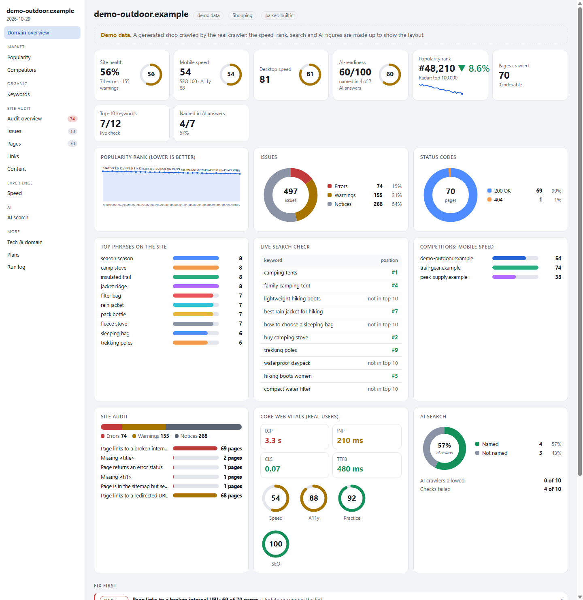
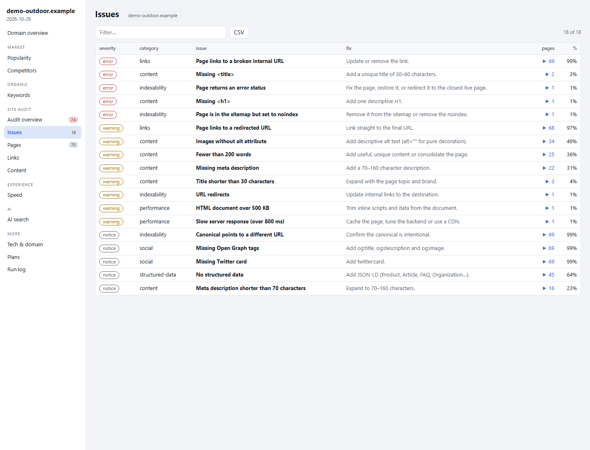
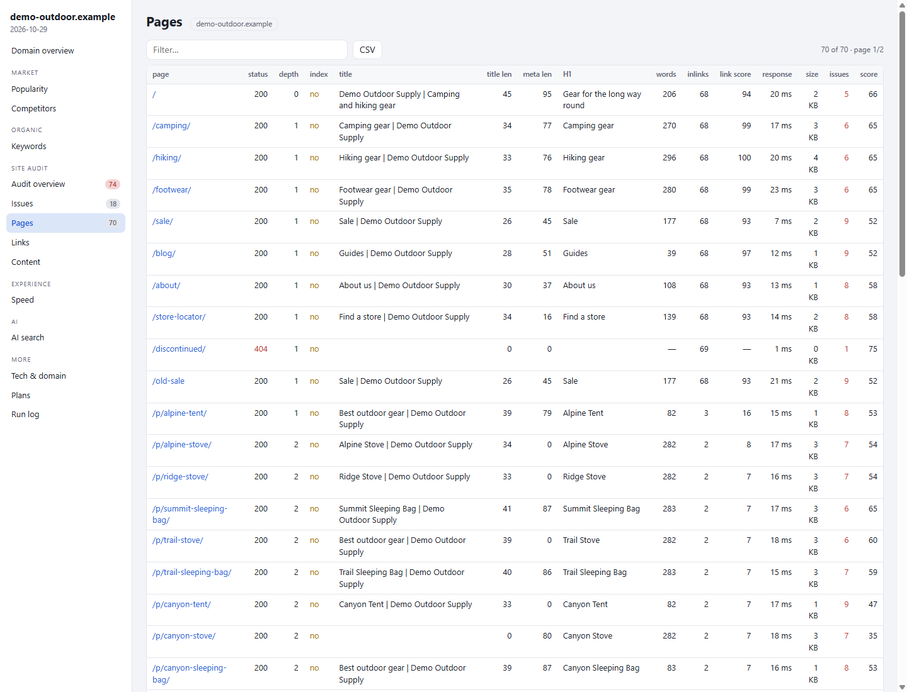
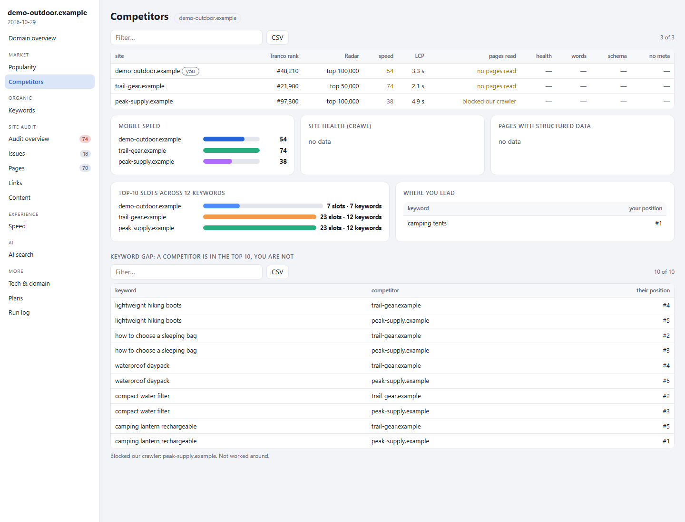
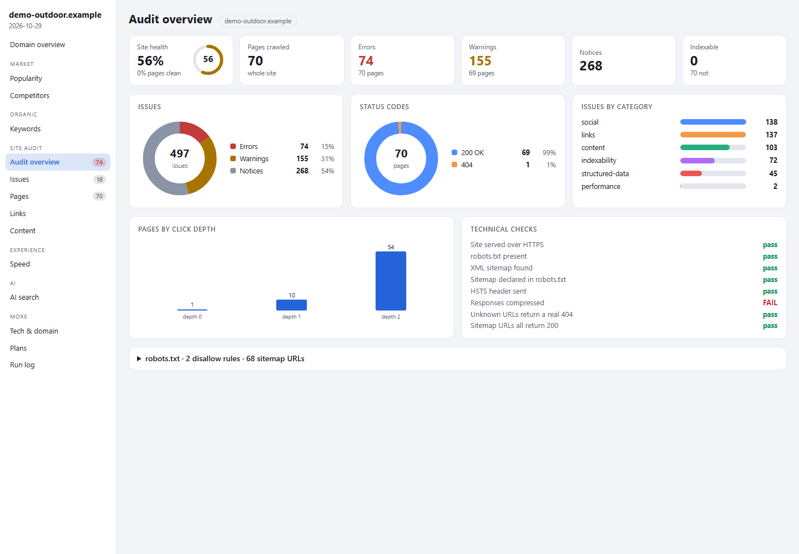

<div align="center">

# super_seo

**An open-source SEO toolkit for the command line.**
Crawl a site, audit it, measure speed, check rankings, test how AI assistants see the brand, compare competitors,
and get an interactive dashboard plus a plain-language report. One command, no dependencies.

[](https://github.com/mridungeorge/super-seo/actions/workflows/ci.yml)
[](LICENSE)




<sub>The dashboard for the generated demo site in <code>examples/demo</code>. Speed, rank, search and AI figures in the demo are made up; the crawl results are real output.</sub>

</div>

```
sm full example.com --competitors rival.com,other.com
```

## What you get

`sm full <site>` writes a folder with:

| File | What it is |
|---|---|
| **`dashboard.html`** | An interactive dashboard: score tiles, charts, and tables you can sort, filter and export (every page, every issue). Opens offline. |
| **`report.html`** / `report.md` | A written report: verdict, technical SEO, competitors, keywords, links, AI search and a 30/60/90 day plan, with the figures behind each claim. |
| `*.json` | The raw data behind every number, one file per step. |

## Features

- **Site audit.** A polite crawler that follows links and samples the sitemap. It records status codes, redirects,
  titles, descriptions, canonicals, headings, structured data, hreflang, images, internal links, click depth, link
  strength, duplicates, broken links and technical checks, and groups them into about 40 issue types, each with
  *why it matters* and *how to fix it*.
- **Speed.** Google PageSpeed Insights (Lighthouse and real-user Core Web Vitals), plus a real-browser test that names
  the slowest element.
- **Popularity.** Tranco and Cloudflare Radar ranks with history, and an optional rough traffic estimate from a model
  you calibrate on traffic you know.
- **Keywords.** Ideas from search suggestions, clustered by intent, a live rank check, and a keyword-gap table against
  competitors.
- **Competitors.** The same crawl, speed and rank checks on competitors you name, side by side.
- **AI search.** How ready the site is for AI assistants (crawler rules, `llms.txt`, structured data) and how often AI
  models name the brand.
- **Over time.** `sm watch` re-measures on a schedule and `sm history` shows the trend.
- **Agent-friendly.** `sm mcp` exposes the read-only checks to AI agents over MCP.

## Quick start

You need **Node.js 24 or newer**. Chrome or Chromium is optional (only `sm probe` uses it).

```bash
git clone https://github.com/mridungeorge/super-seo.git
cd super-seo
node bin/sm.js doctor                    # checks your setup
node bin/sm.js full example.com          # a full scan; open the dashboard it prints
npm link                                 # optional: puts `sm` on your PATH
```

Want to look around first? Open [`examples/demo/dashboard.html`](examples/demo/dashboard.html), or rebuild it with
`node scripts/demo.mjs`. The demo is generated entirely on your machine; no third-party site is involved.

## Unlock the advanced features with free API keys

The tool runs without any keys. Three free ones add the advanced parts. Each takes a few minutes, and anything
missing is skipped and listed in the report.

| Add this key | To get | Where to create it |
|---|---|---|
| `PSI_API_KEY` | Lighthouse scores, real-user Core Web Vitals, the biggest speed fixes, competitor speed comparison | [Google Cloud console](https://console.cloud.google.com/): enable *PageSpeed Insights API*, create an API key |
| `CLOUDFLARE_API_TOKEN` | A second popularity rank, site category, rank history | [Cloudflare dashboard](https://dash.cloudflare.com/): *My Profile → API Tokens → Create Custom Token*, permission *Account → Radar → Read* |
| `NVIDIA_API_KEY` | The written report, strategy and sales plans, the AI-visibility probe | [build.nvidia.com](https://build.nvidia.com/): sign in, open a model, *Get API Key* |
| `BRAVE_API_KEY` *(optional)* | The live rank check and keyword gap | [Brave Search API](https://brave.com/search/api/) |

Put them in a `.env` file (copy [`.env.example`](.env.example)):

```
PSI_API_KEY=...
CLOUDFLARE_API_TOKEN=...
NVIDIA_API_KEY=nvapi-...
```

Step-by-step instructions, limits, safe-handling tips and troubleshooting are in
**[docs/api-keys.md](docs/api-keys.md)**. Prefer a different model provider? Any OpenAI-compatible service or a local
server works through `LLM_API_KEY`, `LLM_MODEL` and `LLM_BASE_URL`. Never commit your `.env`.

## Screenshots

| Issues, with the fix for each | Every crawled page |
|---|---|
|  |  |
| **Competitors and keyword gap** | **Audit overview** |
|  |  |

## Commands

```
sm full <site>            everything: scan, dashboard, written report
sm scan <site>            the collectors and dashboard, no written report
sm crawl <site>           the crawler on its own
sm psi <url>              PageSpeed                 sm probe <url>     real-browser web vitals
sm rank a.com b.com       popularity ranks          sm radar <site>    Cloudflare Radar
sm serp <site> --keywords "x,y"                     live rank check
sm keywords <seed>        keyword ideas             sm geo <site>      AI readiness
sm ai "Brand"             AI-answer probe           sm tech <site>     technology stack
sm intel <site>           domain background         sm wayback <site>  archive history
sm watch <site>           re-measure over time      sm history <site>  show the trend
sm calibrate --csv f      fit a traffic model       sm estimate <site> rough visits from rank
sm mcp                    MCP server for AI agents  sm doctor          check your setup
```

`sm <site>` on its own is the same as `sm full <site>`. Options and details: **[docs/commands.md](docs/commands.md)**.
How the pieces fit together: **[docs/how-it-works.md](docs/how-it-works.md)**.

## How much to trust the numbers

Every figure names its source.

- **Measured:** crawl results, PageSpeed, ranks, DNS, archive history, live search positions.
- **Estimated:** traffic from a rank (typically off by a factor of several, and the tool says so) and anything a
  language model writes. Models can miscalculate, so the evidence given to the model is saved beside the report.
- **Not available:** links from other sites to yours, visit counts for sites you do not run, competitors' full keyword
  lists, search volumes. These need paid indexes or panel data. The tool leaves them blank instead of guessing, and the
  report lists what it could not cover.

## Responsible use

- The crawler **identifies itself** (`super_seo/<version> (SEO crawler; +<repo url>)`), respects `robots.txt`, waits
  between requests and limits concurrency. Set `SM_USER_AGENT` to change the string, and put your fork's URL in
  `src/core/http.js`.
- It **does not try to get around bot protection.** A site that answers 403 or 429 is reported as blocked.
- Only crawl sites you own or have permission to crawl, and follow the terms of every service you connect.
- The live rank check uses the Brave Search API. `--engine bing` and `--engine duckduckgo` read result pages directly,
  which those sites' terms may not allow, so they are opt-in.
- Keyword ideas use public search-suggestion endpoints, which are unofficial.
- Model-written parts send the evidence for that section (measurements about the site) to the provider you configure.
  Nothing else leaves your machine, and there is no telemetry.

## Optional: Scrapling parser

If [Scrapling](https://github.com/D4Vinci/Scrapling) is installed, the crawler uses it to read pages. It only parses HTML
the crawler already fetched.

```bash
python -m venv .venv-scrapling
.venv-scrapling/bin/pip install scrapling        # Windows: .venv-scrapling\Scripts\pip
```

`sm doctor` shows whether it was found. `--engine builtin` forces the built-in parser.

## Contributing

Issues and pull requests are welcome. Please read [CONTRIBUTING.md](CONTRIBUTING.md) first. For security reports see
[SECURITY.md](SECURITY.md). `npm test` runs offline, `npm run check` runs the static checks, `npm run test:live` touches the network, and `npm run demo` rebuilds the demo.

## License

[MIT](LICENSE)
